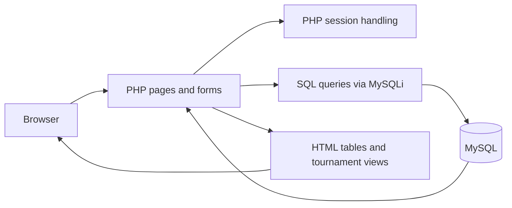
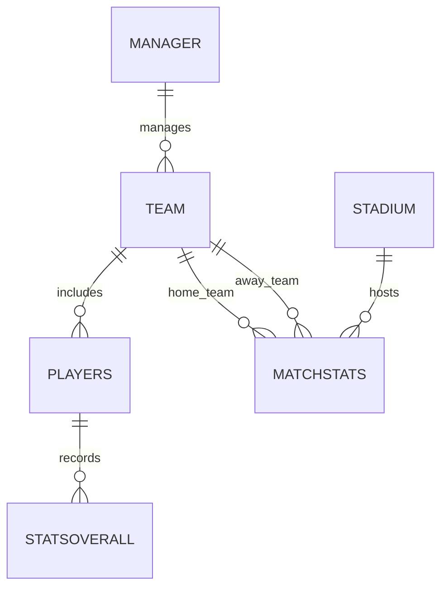

# Football World Cup 2022 App


## Overview

A database-driven web application for exploring historical FIFA World Cup 2022 tournament data. It provides match results, group standings, knockout brackets, player statistics, search and administrative interfaces for managing players and team managers.

The project demonstrates relational database design, SQL-based analytics, server-rendered PHP pages and multi-table CRUD operations. It is an educational application, not a live sports data service or an official FIFA product.

## Dataset at a glance

Counts below reflect records in the supplied SQL dumps, rather than measured application traffic.

| Entity | Records |
|---|---:|
| National teams | 32 |
| Players | 832 |
| Matches | 64 |
| Team managers | 32 |
| Stadiums | 8 |
| Player statistics | 832 |

The database contains seven tables, including the login table, and 1,800 tournament-domain records excluding login accounts (1,802 total records).

## Features

### Tournament exploration

- Group-stage fixtures and historical results.
- Dynamically calculated group standings for groups A–H.
- Knockout bracket from the round of 16 through the final, including the third-place match.
- Player statistics covering goals, assists, cards and saves.
- Player and national team search.
- Aggregate tournament insights, including top scorers and team scoring totals.

### Administration

- Session-based login with user and administrator destinations.
- Create, list, edit and delete player records.
- Manage player statistics associated with player profiles.
- Create, list, edit and delete team manager records.

The application includes administrative interfaces, but its current authentication and authorization implementation requires security hardening before any public deployment.

## Technology stack

| Layer | Technology |
|---|---|
| Backend and rendering | PHP |
| Database | MySQL 8, InnoDB |
| Database access | MySQLi |
| Frontend | HTML, CSS, JavaScript |
| UI | Bootstrap |
| Session management | PHP sessions |

## Architecture



The application follows a server-rendered, page-oriented architecture. PHP scripts handle database queries, business logic and HTML rendering directly. It does not expose a separate REST API.

## Database design



The diagram represents conceptual relationships. Most are enforced by foreign keys; statsoverall.player_id is indexed but has no foreign-key constraint in the supplied dump. Nullable foreign-key columns allow optional references. The independent login table stores account information.

| Table | Responsibility |
|---|---|
| login | Account credentials and user type |
| manager | Manager identity, age and nationality |
| team | National team metadata, group, ranking and manager reference |
| players | Player identity, shirt number, position, club and team reference |
| stadium | Venue name, city and capacity |
| matchstats | Teams, tournament round, result, goals, cards, date and venue |
| statsoverall | Player goals, assists, cards and saves |

The schema uses primary keys, foreign keys and indexes on relationship columns. SQL dumps contain both schema definitions and sample historical data.

## SQL analytics

### Group standings

The group-stage view uses correlated subqueries and conditional aggregation to derive matches played, wins, draws, losses, goals scored, goals conceded and points from match records.

The points calculation assigns three points for a win, one for a draw and zero for a loss.

### Player statistics

Player and team information is joined with aggregate statistics to display scoring contributions, disciplinary records and goalkeeper statistics.

### Tournament insights

SQL aggregation and nested queries are used to calculate team scoring totals, identify teams with high card counts and retrieve leading goal scorers.

The current match schema stores aggregate card counts rather than separate home and away card counts; team disciplinary attribution therefore needs further validation.

## Application pages

| File | Purpose |
|---|---|
| index.php | Login page |
| userhome.php | Group-stage results and standings |
| bracket.php | Knockout results and bracket |
| marcatori.php | Player statistics |
| cautare.php | Player and team search |
| informatii.php | Tournament insights |
| adminpage.php | Administration navigation |
| players.php | Player listing |
| manager.php | Manager listing |
| createplayers.php / updateplayer.php / deleteplayer.php | Player management |
| createmanager.php / update.php / delete.php | Manager management |
| logout.php | Session termination |

## Repository structure

```text
Football-World-Cup-2022-App/
├── Main app/
│   ├── index.php
│   ├── userhome.php
│   ├── bracket.php
│   ├── marcatori.php
│   ├── cautare.php
│   ├── informatii.php
│   ├── adminpage.php
│   ├── players.php
│   ├── manager.php
│   ├── createplayers.php
│   ├── updateplayer.php
│   ├── deleteplayer.php
│   ├── createmanager.php
│   ├── update.php
│   ├── delete.php
│   ├── logout.php
│   ├── image/
│   ├── js/
│   └── styles/
├── WorldCup2022_db/
│   ├── worldcup_login.sql
│   ├── worldcup_manager.sql
│   ├── worldcup_team.sql
│   ├── worldcup_players.sql
│   ├── worldcup_stadium.sql
│   ├── worldcup_matchstats.sql
│   └── worldcup_statsoverall.sql
└── README.md
```

## Local setup

### Prerequisites

- PHP with the MySQLi extension.
- MySQL 8 (the dumps use utf8mb4_0900_ai_ci collation).
- A local PHP web server, or Apache with PHP configured.
- Git.

### 1. Clone the repository

```bash
git clone https://github.com/Claudio1009/Football-World-Cup-2022-App.git
cd Football-World-Cup-2022-App
```

### 2. Initialize the database

Create a local database named worldcup.

```sql
CREATE DATABASE worldcup CHARACTER SET utf8mb4;
```

Import the SQL files from WorldCup2022_db in dependency order:

1. worldcup_manager.sql
2. worldcup_team.sql
3. worldcup_players.sql
4. worldcup_stadium.sql
5. worldcup_matchstats.sql
6. worldcup_statsoverall.sql
7. worldcup_login.sql

Use MySQL Workbench, phpMyAdmin or the MySQL CLI. The login dump contains legacy demonstration credentials; use only disposable local accounts and never reuse real passwords.

### 3. Configure database access

The existing PHP pages contain inline MySQL connection settings. Update them to match a dedicated local database account with the necessary permissions.

Do not expose the database or application publicly, use privileged database accounts unnecessarily, or commit real credentials. Centralizing configuration and migrating to password hashing are recommended improvements.

### 4. Start the application

From the repository root, run PHP's development server:

```bash
php -S 127.0.0.1:8000 -t "Main app"
```

Open http://127.0.0.1:8000/index.php.

Alternatively, serve the Main app directory through a locally configured Apache installation.

## Validation and testing

The repository includes SQL seed data for manual verification. Suggested checks:

- Verify imported entity counts against the dataset table.
- Compare group standings with the stored match results.
- Check player and team search results.
- Exercise player and manager CRUD on disposable data.
- Verify session handling and role restrictions on each administrative operation.

No automated test suite or successful execution is asserted.

## Limitations and roadmap

- Replace interpolated SQL queries with prepared statements.
- Replace plaintext password storage and comparison with password hashing and verification.
- Centralize database configuration and remove committed credentials.
- Enforce administrator authorization on every administrative action.
- Protect state-changing requests against CSRF and replace GET-based deletion links.
- Use transactions for player and statistics updates.
- Avoid database writes during standings rendering.
- Validate tournament tie-breaking and team-level card attribution.
- Improve foreign-key-aware deletion behavior and input validation.
- Separate data access, business logic and presentation layers.
- Add automated tests and reproducible local deployment.

These are proposed improvements, not implemented features. The project should be treated as a local educational prototype.

## Author

Claudiu Marius Ciupitu — [GitHub](https://github.com/Claudio1009)
